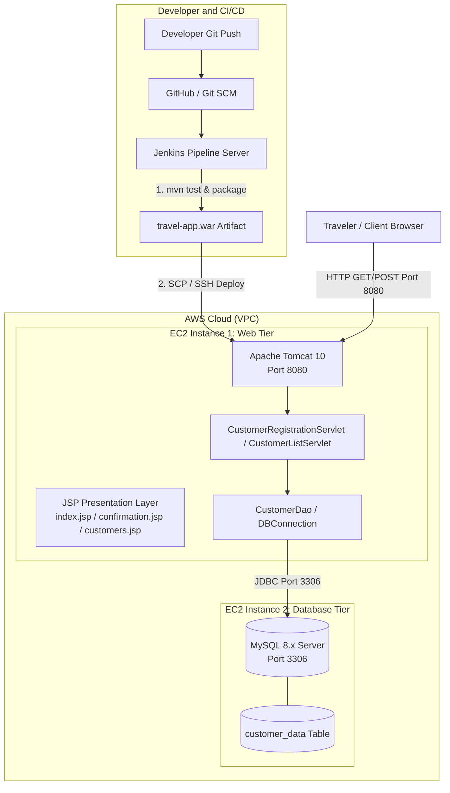

# ✈️ Travel App - Jakarta EE & Advanced Servlet Web Application

A full-stack, enterprise-grade Java Web Application built with **Jakarta EE 10 / Servlet 6.0**, **JSP**, **JavaBeans**, and **DAO Pattern**, configured for production deployment on **Apache Tomcat 10** across **two AWS EC2 instances** (Tomcat Web Tier + MySQL Database Tier) and automated with a **Jenkins CI/CD Pipeline**.

---

## 📌 Architecture Overview



### Key Technical Specs
- **Application Name**: Travel App (`travel-app.war`)
- **Web Technologies**: Jakarta EE 10, Servlet 6.0 (`jakarta.servlet.*`), JSP 3.1, JSTL 3.0
- **Design Pattern**: MVC (Model: `CustomerBean`, View: JSP/CSS, Controller: Servlets, Data Access: DAO)
- **Target Table**: `customer_data` in database `travel_db`
- **Application Server**: Apache Tomcat 10.1+
- **Database**: MySQL 8.x (on dedicated AWS EC2 instance, with SQLite zero-config fallback for testing)
- **CI/CD**: Jenkins Declarative Pipeline (`Jenkinsfile`)

---

## 📂 Project Directory Structure

```text
tomcat-java-app/
├── pom.xml                               # Maven project configuration (Jakarta EE 10, MySQL, SQLite)
├── Jenkinsfile                           # Jenkins Declarative CI/CD Pipeline script
├── README.md                             # Comprehensive documentation & deployment guide
├── sql/
│   └── schema.sql                        # Database initialization & customer_data schema
└── src/
    ├── main/
    │   ├── java/
    │   │   └── com/
    │   │       └── travelapp/
    │   │           ├── bean/
    │   │           │   └── CustomerBean.java       # JavaBean model with BMI categories
    │   │           ├── dao/
    │   │           │   ├── CustomerDao.java        # DAO interface
    │   │           │   └── CustomerDaoImpl.java    # DAO implementation with PreparedStatement
    │   │           ├── servlet/
    │   │           │   ├── CustomerRegistrationServlet.java  # Handles form submission & validation
    │   │           │   └── CustomerListServlet.java          # Queries & lists customer_data
    │   │           └── util/
    │   │               └── DBConnection.java       # Connection provider with auto-init & env overrides
    │   ├── resources/
    │   │   └── db.properties             # DB configuration (host, credentials, mode)
    │   └── webapp/
    │       ├── WEB-INF/
    │       │   └── web.xml               # Jakarta EE 10 deployment descriptor
    │       ├── css/
    │       │   └── style.css             # Modern glassmorphic responsive stylesheet
    │       ├── js/
    │       │   └── app.js                # Interactive BMI calculator & live search
    │       ├── index.jsp                 # Registration form with mandatory fields
    │       ├── confirmation.jsp          # Boarding pass / registration receipt
    │       ├── customers.jsp             # Live customer_data table view
    │       └── error.jsp                 # Friendly error page with EC2 troubleshooting
    └── test/
        └── java/
            └── com/
                └── travelapp/
                    ├── CustomerBeanTest.java       # Unit tests for bean and BMI categorization
                    └── CustomerDaoTest.java        # Integration test using isolated SQLite DB
```

---

## 📋 Form Fields Specification

The registration form (`index.jsp`) captures and saves the following attributes into `customer_data`:

| Field Name | Type | Form Input | Description & Rules |
| :--- | :--- | :--- | :--- |
| **Full Name** | `VARCHAR(100)` | Text | Legal traveler name (Mandatory) |
| **Age** | `INT` | Number | Age in years (Mandatory, 1 - 120) |
| **Gender** | `VARCHAR(20)` | Select | Male, Female, Non-Binary, Prefer not to say (Mandatory) |
| **BMI** | `DECIMAL(5,2)` | Number / Calc | Body Mass Index with integrated Height/Weight calculator |
| **Desired Country** | `VARCHAR(100)` | Text | **Mandatory text fill** destination + quick-pick chips |
| **Created At** | `TIMESTAMP` | Auto | Server timestamp when the record is created |

---

## 🗄️ Database Setup (`customer_data`)

The database script is located at [`sql/schema.sql`](file:///d:/tomcat-java-app/sql/schema.sql):

```sql
CREATE DATABASE IF NOT EXISTS travel_db
  CHARACTER SET utf8mb4
  COLLATE utf8mb4_unicode_ci;

USE travel_db;

CREATE TABLE IF NOT EXISTS customer_data (
    id INT AUTO_INCREMENT PRIMARY KEY,
    name VARCHAR(100) NOT NULL,
    age INT NOT NULL,
    gender VARCHAR(20) NOT NULL,
    bmi DECIMAL(5,2) NOT NULL,
    desired_country VARCHAR(100) NOT NULL,
    created_at TIMESTAMP DEFAULT CURRENT_TIMESTAMP
) ENGINE=InnoDB DEFAULT CHARSET=utf8mb4 COLLATE=utf8mb4_unicode_ci;

CREATE INDEX idx_customer_country ON customer_data(desired_country);
```

---

## ☁️ Step-by-Step AWS EC2 Deployment Guide (2 EC2 Instances)

### Step 1: Create AWS Security Groups

Create two security groups in the AWS VPC Management Console:

#### A. Security Group for MySQL (`sg-travel-mysql`)
- **Inbound Rules**:
  - **Type**: MySQL/Aurora (Port `3306`)
    - **Source**: Select `Custom` -> Enter the Security Group ID of the Tomcat EC2 instance (`sg-travel-tomcat`) or Tomcat's Private IP (e.g. `172.31.x.x/32`). *Do not expose 3306 to 0.0.0.0/0*.
  - **Type**: SSH (Port `22`)
    - **Source**: Your Admin IP (`My IP`).

#### B. Security Group for Tomcat (`sg-travel-tomcat`)
- **Inbound Rules**:
  - **Type**: Custom TCP (Port `8080`)
    - **Source**: `0.0.0.0/0` (Anywhere) or your company VPN.
  - **Type**: SSH (Port `22`)
    - **Source**: Your Admin IP / Jenkins Server IP.

---

### Step 2: Configure EC2 Instance #1 — MySQL Database

1. **Launch Instance**:
   - **Name**: `TravelApp-MySQL-Server`
   - **Instance Type**: `t2.micro` (Free Tier eligible)
   - **AMI**: Ubuntu 22.04 LTS
   - **Security Group**: Assign `sg-travel-mysql`
   - **Key Pair**: Select your `.pem` key pair.

2. **SSH into the MySQL EC2 Instance**:
   ```bash
   ssh -i your-key.pem ubuntu@<MYSQL_EC2_PUBLIC_IP>
   ```

3. **Install and Start MySQL Server**:
   ```bash
   sudo apt update
   sudo apt install mysql-server -y
   sudo systemctl enable mysql
   sudo systemctl start mysql
   ```

4. **Allow Remote Connections from Tomcat**:
   Edit the MySQL configuration file:
   ```bash
   sudo nano /etc/mysql/mysql.conf.d/mysqld.cnf
   ```
   Change line:
   ```ini
   bind-address = 127.0.0.1
   ```
   To:
   ```ini
   bind-address = 0.0.0.0
   ```
   Save and restart MySQL:
   ```bash
   sudo systemctl restart mysql
   ```

5. **Create Database, Table, and Remote User**:
   Open MySQL root shell:
   ```bash
   sudo mysql
   ```
   Run the following commands:
   ```sql
   CREATE DATABASE travel_db CHARACTER SET utf8mb4 COLLATE utf8mb4_unicode_ci;

   -- Create user accessible from the Tomcat EC2 instance
   CREATE USER 'traveluser'@'%' IDENTIFIED BY 'TravelPass123!';
   GRANT ALL PRIVILEGES ON travel_db.* TO 'traveluser'@'%';
   FLUSH PRIVILEGES;

   USE travel_db;

   CREATE TABLE customer_data (
       id INT AUTO_INCREMENT PRIMARY KEY,
       name VARCHAR(100) NOT NULL,
       age INT NOT NULL,
       gender VARCHAR(20) NOT NULL,
       bmi DECIMAL(5,2) NOT NULL,
       desired_country VARCHAR(100) NOT NULL,
       created_at TIMESTAMP DEFAULT CURRENT_TIMESTAMP
   );

   EXIT;
   ```

6. Note down the **Private IPv4 Address** of this instance (e.g. `172.31.25.110`).

---

### Step 3: Configure EC2 Instance #2 — Tomcat 10 Application Server

1. **Launch Instance**:
   - **Name**: `TravelApp-Tomcat-Server`
   - **Instance Type**: `t2.micro` (Free Tier eligible)
   - **AMI**: Ubuntu 22.04 LTS
   - **Security Group**: Assign `sg-travel-tomcat`
   - **Key Pair**: Select your `.pem` key pair.

2. **SSH into the Tomcat EC2 Instance**:
   ```bash
   ssh -i your-key.pem ubuntu@<TOMCAT_EC2_PUBLIC_IP>
   ```

3. **Install OpenJDK 17**:
   ```bash
   sudo apt update
   sudo apt install openjdk-17-jdk -y
   java -version
   ```

4. **Install Apache Tomcat 10**:
   ```bash
   # Create tomcat user and directory
   sudo useradd -m -U -d /opt/tomcat10 -s /bin/false tomcat

   # Download Tomcat 10.1
   cd /tmp
   wget https://archive.apache.org/dist/tomcat/tomcat-10/v10.1.20/bin/apache-tomcat-10.1.20.tar.gz

   # Extract to /opt/tomcat10
   sudo mkdir -p /opt/tomcat10
   sudo tar -xf apache-tomcat-10.1.20.tar.gz -C /opt/tomcat10 --strip-components=1
   sudo chown -R tomcat:tomcat /opt/tomcat10
   sudo chmod -R u+x /opt/tomcat10/bin
   ```

5. **Configure Database Environment Variables in Tomcat**:
   Create or edit `/opt/tomcat10/bin/setenv.sh`:
   ```bash
   sudo nano /opt/tomcat10/bin/setenv.sh
   ```
   Add:
   ```bash
   #!/bin/sh
   export DB_TYPE="mysql"
   export DB_HOST="172.31.25.110"    # <-- Replace with MySQL EC2 Private IP!
   export DB_PORT="3306"
   export DB_NAME="travel_db"
   export DB_USER="traveluser"
   export DB_PASSWORD="TravelPass123!"
   ```
   Make it executable:
   ```bash
   sudo chmod +x /opt/tomcat10/bin/setenv.sh
   ```

6. **Create a Systemd Service for Tomcat 10**:
   ```bash
   sudo nano /etc/systemd/system/tomcat10.service
   ```
   Paste the following:
   ```ini
   [Unit]
   Description=Apache Tomcat 10 Web Application Container
   After=network.target

   [Service]
   Type=forking

   User=tomcat
   Group=tomcat

   Environment="JAVA_HOME=/usr/lib/jvm/java-17-openjdk-amd64"
   Environment="CATALINA_PID=/opt/tomcat10/temp/tomcat.pid"
   Environment="CATALINA_HOME=/opt/tomcat10"
   Environment="CATALINA_BASE=/opt/tomcat10"

   ExecStart=/opt/tomcat10/bin/startup.sh
   ExecStop=/opt/tomcat10/bin/shutdown.sh

   RestartSec=10
   Restart=always

   [Install]
   WantedBy=multi-user.target
   ```
   Start and enable the service:
   ```bash
   sudo systemctl daemon-reload
   sudo systemctl enable tomcat10
   sudo systemctl start tomcat10
   sudo systemctl status tomcat10
   ```

---

## 🚀 Jenkins CI/CD Pipeline Setup

The [`Jenkinsfile`](file:///d:/tomcat-java-app/Jenkinsfile) in this repository provides automated continuous delivery.

### 1. Prerequisites on Jenkins Server
- **Jenkins Plugins**:
  - `SSH Agent Plugin`
  - `Pipeline`
  - `Git Plugin`
  - `JUnit Plugin`
- **Global Tool Configuration**:
  - JDK: `JDK-17`
  - Maven: `Maven-3.9`

### 2. Configure Jenkins Credentials
1. Navigate to **Manage Jenkins** -> **Credentials** -> **System** -> **Global credentials (unrestricted)**.
2. Click **Add Credentials**:
   - **Kind**: `SSH Username with private key`
   - **ID**: `aws-ec2-ssh-key`
   - **Username**: `ubuntu`
   - **Private Key**: Paste the contents of your AWS `.pem` private key file.
3. Click **Add Credentials** (Secret Text):
   - **Kind**: `Secret text`
   - **ID**: `TOMCAT_EC2_HOST`
   - **Secret**: Enter the Public IP or DNS of the Tomcat EC2 instance (e.g. `54.210.xx.xx`).

### 3. Create the Pipeline Job
1. In Jenkins dashboard, click **New Item** -> enter `Travel-App-Pipeline` -> select **Pipeline**.
2. Scroll to the **Pipeline** section:
   - **Definition**: `Pipeline script from SCM`
   - **SCM**: `Git`
   - **Repository URL**: `https://github.com/your-username/travel-app.git`
   - **Branch**: `*/main`
   - **Script Path**: `Jenkinsfile`
3. Click **Save** and trigger **Build Now**.

---

## 💻 Local Build & Verification

### 1. Build the WAR with Maven
```bash
mvn clean package
```
- This compiles all Java classes, executes JUnit 5 tests, and outputs:
  - `target/travel-app.war`

### 2. Local Testing (Zero-Config SQLite Mode)
If you do not have MySQL running locally, simply test with SQLite:
- In `src/main/resources/db.properties`, set:
  ```properties
  db.type=sqlite
  sqlite.filepath=travel_app.db
  ```
The app will auto-create the `customer_data` table locally upon first request.

### 3. Deploying to Local Tomcat 10
Copy the WAR file into your Tomcat `webapps` folder:
```bash
cp target/travel-app.war /path/to/tomcat10/webapps/ROOT.war
# or keep the context path:
cp target/travel-app.war /path/to/tomcat10/webapps/travel-app.war
```
Access the application:
- Registration Form: `http://localhost:8080/travel-app/` or `http://localhost:8080/`
- View Database Records: `http://localhost:8080/travel-app/customers`

---

## 🧪 Testing the Live Application

1. Open your browser and navigate to:
   ```text
   http://<TOMCAT_EC2_PUBLIC_IP>:8080/travel-app/
   ```
2. Fill out the registration form:
   - **Full Name**: e.g., `Sophia Martinez`
   - **Age**: `28`
   - **Gender**: `Female`
   - **BMI**: Enter `21.45` or enter Height `168` cm and Weight `60` kg using the auto-calculator.
   - **Desired Country to Travel**: e.g. `Switzerland` (or click one of the destination chips).
3. Click **Submit & Save to Database**.
4. You will be directed to the **Registration Confirmed** page with a boarding receipt and assigned Database ID `#1`.
5. Click **View All in Database** to review the live table `customer_data`.
